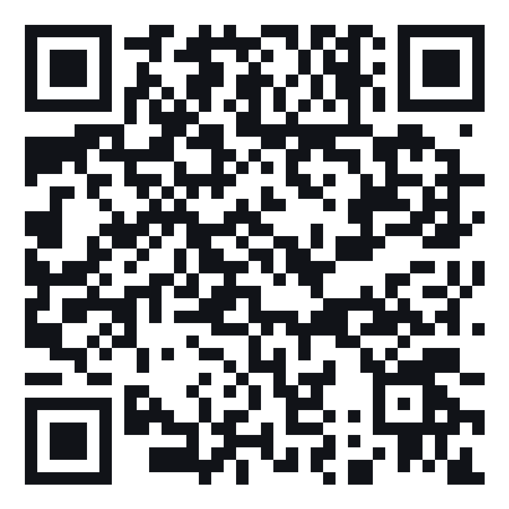
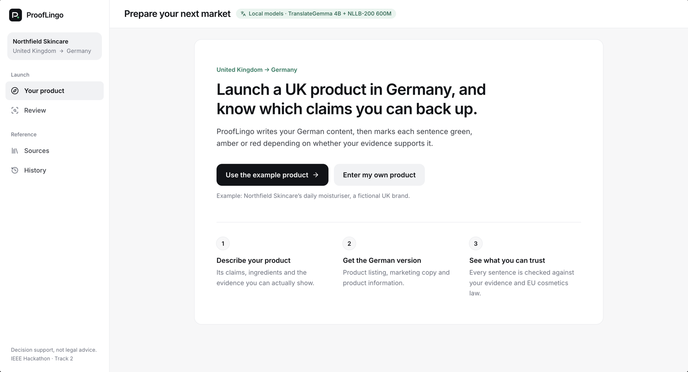
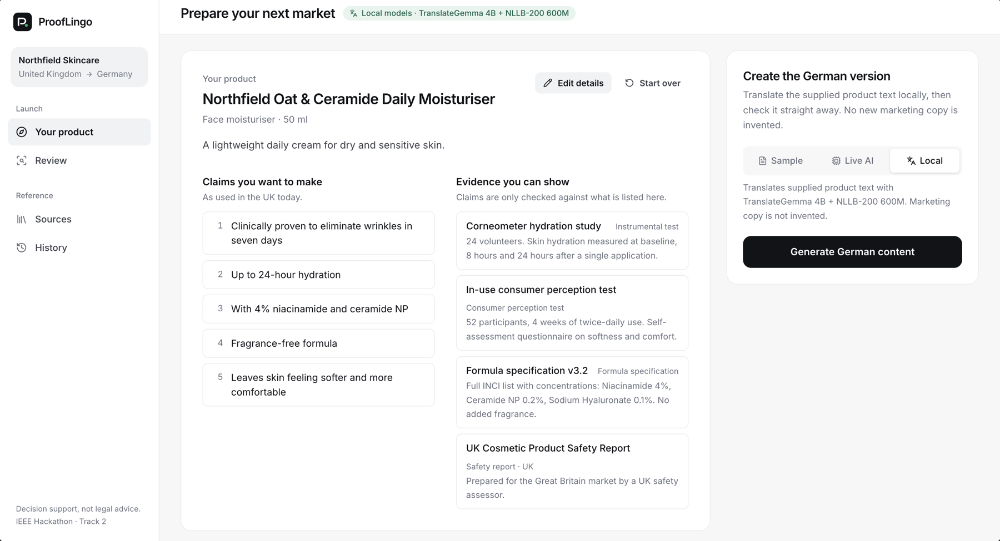
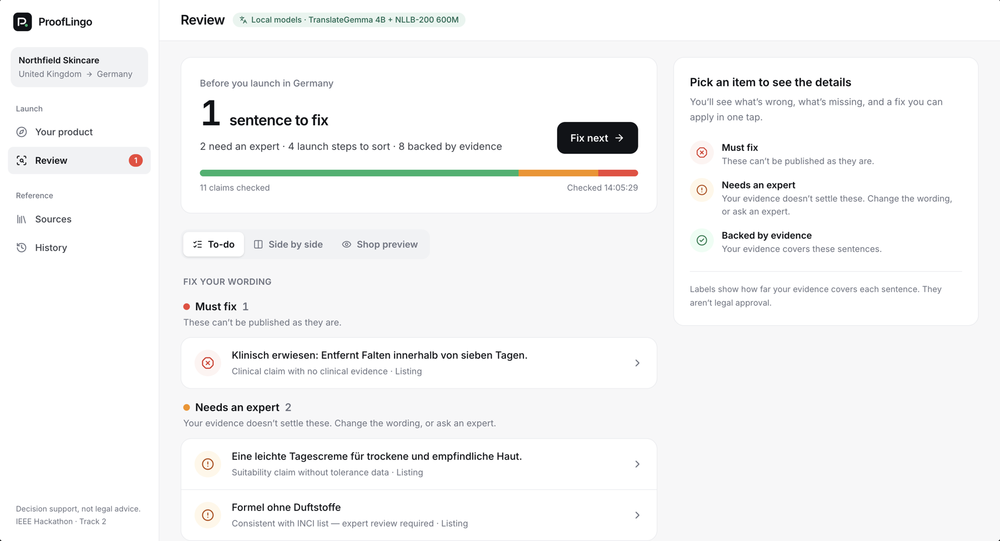
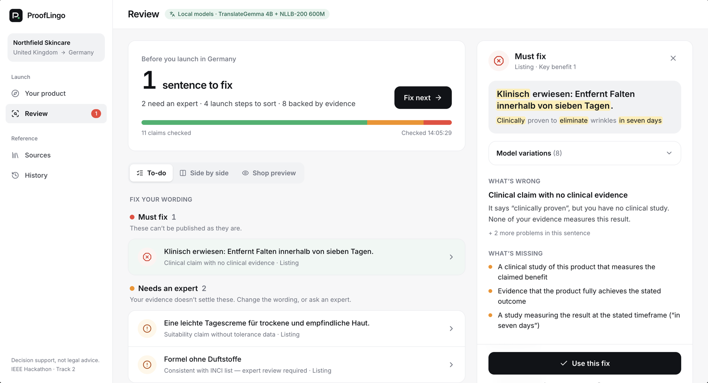
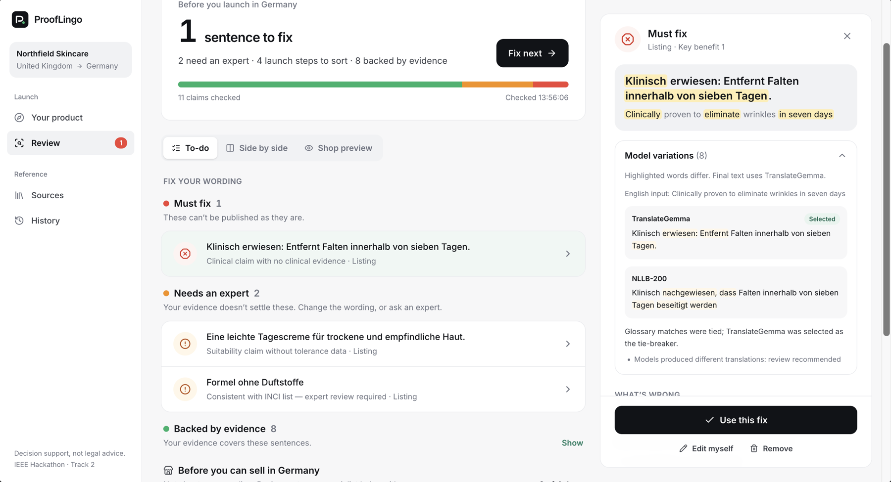
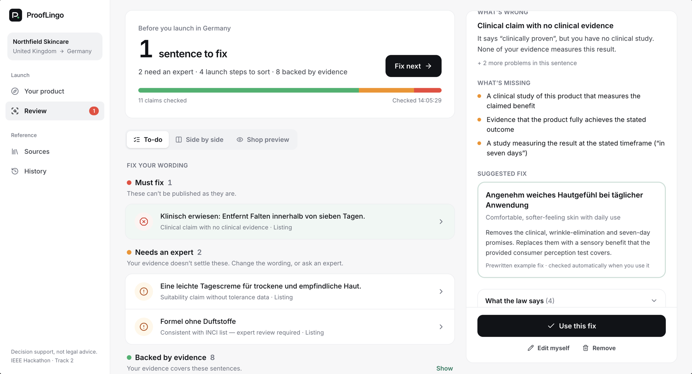
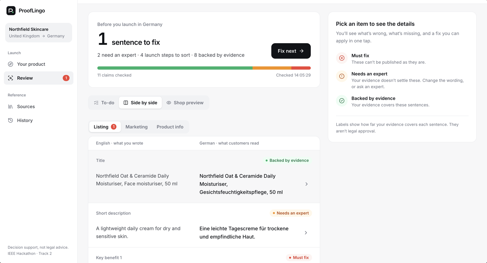
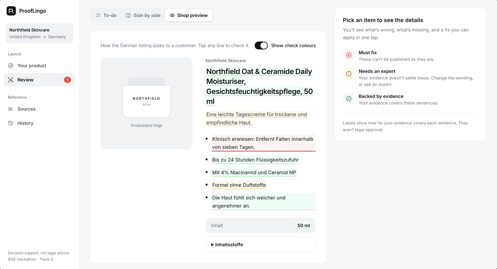

# ProofLingo: Trust-Aware Market Entry Pipeline

🥈 **2nd place, IEEE Hackathon at City St George's, University of London, 12 November 2026**

Built in 24 hours by a team of 5 for The 48 Group's Track 2 challenge, **Scaling Globally with AI**.

**Live demo:** https://prooflingo-ieee.netlify.app



## The challenge

Help a UK SME take a product into a new international market by localising its listings, marketing and documentation (language and culture), checking them against local regulations, and clearly flagging where the AI's outputs can and cannot be trusted.

## What we built

ProofLingo doesn't just translate. It writes your German content, then tells you **which claims you can back up, which need a human, and why.** It translates the supplied product text only: no new marketing copy is invented.

The demo uses a fictional UK brand, Northfield Skincare, launching its Oat & Ceramide Daily Moisturiser in **Germany**. You list the claims you want to make and the evidence you can show, and every sentence is checked against that evidence and EU cosmetics law, then sorted into:

- **Must fix:** sentences that can't be published as they are
- **Needs an expert:** your evidence doesn't settle these, so change the wording or ask an expert
- **Backed by evidence:** your evidence covers these sentences
- **Launch steps:** what you still need to sort before you can sell in Germany

### Screenshots

All screenshots are of the app running in Local mode and are stored in [`docs/local-app-screenshots/`](docs/local-app-screenshots/).

**1. Home** (`01-home.png`): the landing screen explains the three steps (describe your product, get the German version, see what you can trust) and offers the example product or your own. The badge shows the local models are active.



**2. Your product** (`02-your-product.png`): the claims the brand wants to make, the evidence it can show, and the Sample / Live AI / Local mode toggle with the **Generate German content** button.



**3. Review overview** (`03-review-overview.png`): the result at a glance: 1 sentence to fix, 2 that need an expert, 4 launch steps and 8 backed by evidence, across 11 claims checked.



**4. Must fix details** (`04-must-fix-details.png`): selecting a sentence shows what's wrong ("clinically proven" with no clinical study) and what's missing from the evidence.



**5. Model variations** (`05-model-variations.png`): TranslateGemma and NLLB-200 side by side, with differing words highlighted, the selection reason (glossary tie, so TranslateGemma) and a review flag where the models disagree.



**6. Suggested fix** (`06-suggested-fix.png`): a replacement sentence that removes the clinical, wrinkle and seven-day promises and relies on the consumer perception test, with a "What the law says" section and options to use the fix, edit it or remove the sentence.



**7. Side by side** (`07-side-by-side.png`): the English and German text for each field (listing, marketing, product info), each labelled must fix, needs an expert or backed by evidence.



**8. Shop preview** (`08-shop-preview.png`): how the German listing looks to a customer, with an optional colour overlay showing each sentence's check result.



### Three modes

| Mode | What it does |
|------|--------------|
| **Sample** | Built-in German sample content. Needs no API key. |
| **Live AI** | A structured call to a cloud AI model, validated against a schema. This is what the hosted demo uses. |
| **Local** | Translates with two open models on your own machine: **TranslateGemma 4B** and **NLLB-200 600M**. |

In Local mode the review screen shows each model's translation side by side and highlights the words that differ. When the glossary matches are tied, TranslateGemma is selected as the tie-breaker, and sentences where the models disagree are marked for review. The local models can't be hosted online, so Local mode only works when the app and the models run on the same machine. We developed and demoed it on an Apple Silicon Mac (M3 Pro, 18 GB).

For how Local mode works and why each feature matters, see [Local mode: how it works and why](docs/local-mode.md).

### Pipeline

```
Input (product facts, claims, evidence)
   ↓
[1] Localise: German content with cultural adaptation and a product glossary
   ↓
[2] Regulatory check: flags with citations to curated sources
   ↓
[3] Trust layer: evidence matching, glossary consistency, model disagreement
    → must fix / needs an expert / backed by evidence, with reasons
   ↓
[4] UI: To-do, side-by-side and shop preview views, with fix, edit or remove actions
```

Regulatory fact lines (such as size, ingredient list, Responsible Person, safety report and CPNP notification) are built from the product facts, never written by a model.

## Status and limitations

- **German only.** A second market through a config change was a stretch goal, not delivered.
- **No cloud model in Local mode yet.** We planned to compare a cloud model against the two local models in the same view. That needs an API key in the local setup and is a next step.
- **Not legal advice.** The app says so on every screen: it is decision support. Uncertain output goes to human review.
- **Curated, not comprehensive.** A small set of relevant legal excerpts, not whole statutes.

## Principles

- **Honesty over polish.** If no regulation source is retrieved, we say "no source found". We never guess.
- **Few, explainable trust signals.** Every signal can be described in one sentence.
- **Curate, don't crawl.** 10-20 relevant legal excerpts beat whole statutes.
- **Scope discipline.** One product and one market until the end-to-end demo works.

## Team

Led by Theanesh, who split the work across the team.

| Name | Contribution |
|------|--------------|
| Theanesh | Team lead. Localisation (Module 1): translation and cultural adaptation, glossary, and the local AI integration with TranslateGemma and NLLB-200 |
| Yariel | Built the app from the ground up (Module 4): UI, wiring the modules together, deployment and backup demo video. Greatly improved the slides |
| Hassan | Slides and pitch |
| Adil | Regulatory (Module 2): curated law excerpts, retriever, flags with exact citations |
| Harun | Trust and evaluation (Module 3): trust signals and scoring |

## Shared data contract

Every module reads and writes this shape:

```json
{
  "segment_id": "listing_03",
  "source": "...",
  "localised": "...",
  "reg_flags": [{"issue": "...", "citation": "Reg X, Art. Y", "severity": "high"}],
  "trust": {"score": 0.72, "status": "amber", "reasons": ["back-translation drift", "no source found for claim"]}
}
```

## Repo structure

```
/localise     # Module 1: compose.ts
/regulatory   # Module 2: sources.ts
/trust        # Module 3: rules.ts
/app          # Module 4: UI and integration
/data         # shared types and sample data
/eval         # tests
/docs         # QR code, the Local mode guide and local-app-screenshots/
```

Each folder has a README describing what's in it. The modules are TypeScript and are wired into the working app in `/app`.

## Run it

The working demo lives in `/app`. It needs Node 22+ and runs without any API key.

```bash
cd app
npm install
npm run dev
```

Open http://localhost:5173 and click **Use the example product → Generate German content → Review and fix**. Choose **Sample**, **Live AI** or **Local** in the mode toggle before generating.

- **Live AI (optional):** copy `app/.env.example` to `app/.env`, add your own `ANTHROPIC_API_KEY`, then restart. `.env` is git-ignored, so never commit keys.
- **Checks:** `npm test` · `npm run typecheck` · `npm run build`
- **More:** setup details, the 90-second demo script, and how each module plugs in are in [`app/README.md`](app/README.md).

## Next steps

- Add the cloud model to Local mode, so TranslateGemma, NLLB-200 and a cloud model can be compared side by side
- Add more target markets
- Expand regulatory coverage and run a proper evaluation (for example on FLORES-200)

## Key resources

- UK Trade Tariff · UK legislation · EUR-Lex · China National Laws DB · China-Britain Business Council
- Meta NLLB (translation) · FLORES-200 (quality testing) · LangChain / LlamaIndex
- Research: Brynjolfsson et al. (eBay machine translation study), WTO *Trading with Intelligence*, MuBench, mSTEB
